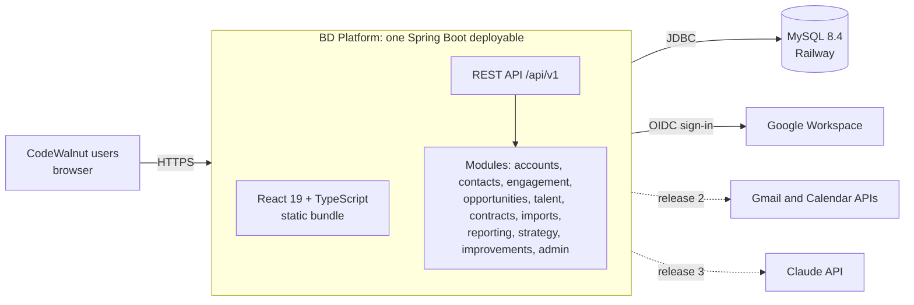

# Architecture overview

Status: **draft for review**.

## Shape

One Spring Boot application serves a REST API and the built React front end,
backed by one MySQL database. With about 10 users, there is no case for
microservices, a message broker or a separate identity server (ADR-0003).

## Technology stack (ADR-0002)

| Layer | Choice |
|---|---|
| Back end | Java 25, Spring Boot 4.1, Spring Security, Spring JDBC `JdbcClient` (ADR-0008), Spring Modulith for module boundaries |
| Database | MySQL 8.4, Flyway migrations |
| Front end | React 19, TypeScript, Vite, TanStack Query, a component library to be chosen in the screens step |
| API contract | OpenAPI 3.1, written first; TypeScript client generated from it |
| Spreadsheet parsing | Apache POI (XLSX) and Commons CSV |
| Sign-in | Google Workspace OpenID Connect, restricted to the CodeWalnut domain (ADR-0004) |
| Tests | JUnit 5, Testcontainers (MySQL), Vitest, Playwright for key journeys |
| Build and run | Maven, one container image, GitHub Actions for tests, Railway for deployment |

## Modules

Each module owns its tables and exposes a Java API to other modules; no
module reads another's tables directly. Spring Modulith tests enforce this.

| Module | Owns | Requirement areas |
|---|---|---|
| `accounts` | Parent companies, accounts (centres), owners, saved lists | 1 |
| `contacts` | Contacts, personas, consent; connections (people the team knows) and warm paths into accounts | 2 |
| `engagement` | Activities (touches), conversations and their next steps, referrals; cadences in release 2 | 3 |
| `opportunities` | Opportunities, requirement lines, stages, forecast | 4 |
| `talent` | Engineers, skills, availability, proposals of engineers to requirements | 5 |
| `contracts` | MSAs, SOWs, deployments of engineers to clients | 6, 7, 11 |
| `imports` | Upload batches, validation, row errors, commit (ADR-0006) | 11 |
| `reporting` | Read-only views across modules: account, contact, contract, engineer and deployment lists; dashboards and CSV export later | 9 |
| `strategy` | The BD strategy page and its versions (backlog item 2) | — |
| `improvements` | Improvement areas for the platform and the build queue (backlog item 5) | — |
| `admin` | Users, roles, sign-in, picklists, stage definitions | 10 |
| `shared` | Roles, current user, audit log, error handling (open to all modules) | — |

## Cross-cutting

- **Authorisation**: role checks on every endpoint; field-level restriction of
  bill rates, contract values and engineer personal data (FR-EXI-08).
- **Audit**: every write records who, when and the changed fields
  (NFR-BD-03), in the same transaction as the change.
- **Configuration over code**: stages, personas, picklists and alert
  thresholds are data (FR-ADM-02, NFR-BD-11).
- **Hosting**: Railway for now (ADR-0007): one service built from the
  repository's Dockerfile, plus Railway's MySQL service. The application is a
  single container plus MySQL, so it can move to AWS, Azure or Google Cloud
  later without code changes.

## Open questions

1. Who operates the application day to day: CodeWalnut's own engineers?
