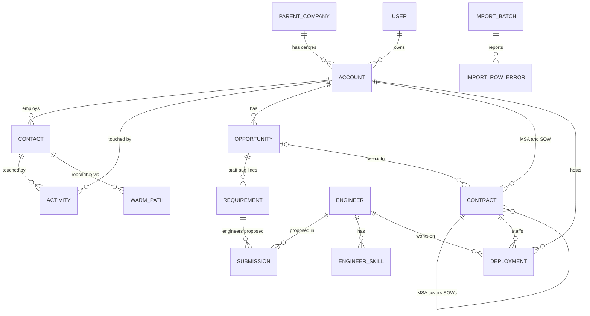

# Domain model

Status: **draft for review**. Covers release 1, with release 2 and 3 additions
marked.

## Overview

## Entities

### Parent company and account (module `accounts`)

- **Parent company**: the multinational that owns one or more centres. Name,
  HQ country, industry, website domain.
- **Account**: one GCC or enterprise centre (BR-BD-01). Name, parent company,
  city, website domain, industry, headcount band, year established, technology
  stack (list), functions served, owner (a user), relationship, notes.
- **Relationship**: `PROSPECT`, `CLIENT` or `PAST_CLIENT`. It becomes `CLIENT`
  when the account has an active contract, and `PAST_CLIENT` when its last
  contract ends.
- Invariants: website domain + city is unique (BR-BD-01); exactly one owner
  (BR-BD-02).

### Contact (module `contacts`)

- Name, title, persona, LinkedIn profile URL, business email, phone, city,
  account, source, consent basis, opted-out flag and date.
- **Persona**: configurable list; defaults are centre head, engineering leader,
  product leader, talent acquisition, vendor management or procurement.
- **Warm path**: how CodeWalnut can reach a contact: shared former employer,
  CodeWalnut employee connection, existing client referral, alumni network.
- Invariants: source is required (FR-CON-06); an opted-out contact is never in a
  cadence (BR-BD-05, release 2).

### Activity (module `engagement`)

- One touch: channel (LinkedIn connection, LinkedIn message, InMail, email,
  call, meeting, event, referral), date, user, account, contact (optional),
  summary, outcome (no reply, replied, meeting booked, not interested,
  referred on).
- Activities are append-only; corrections add a new activity.
- Release 2 adds cadences and tasks.

### Opportunity (module `opportunities`)

- Account, type (`STAFF_AUGMENTATION` or `PROJECT`; `AI_POD` in release 3),
  name, owner, stage, value, currency, probability, expected close date, loss
  reason.
- **Stages** (configurable, FR-OPP-04): Lead → Qualified → Discovery → Proposal
  → Negotiation → Won | Lost.
- **Requirement** (staff augmentation only): role, skills, seniority, count,
  location or remote, start date, duration in months, rate, rate unit.
- **Project details** (project only): scope summary, pricing model (fixed
  price or time and materials), estimate, team shape, timeline.
- Invariants:
  - Qualified needs a named decision-maker contact, a stated need and a target
    start date (BR-BD-07).
  - A staff augmentation opportunity needs at least one complete requirement
    before Proposal (BR-BD-08).
  - Lost needs a loss reason from the configured list (BR-BD-13).
  - Won staff augmentation creates an open deployment request per requirement
    for Delivery (BR-BD-12).
- Weighted value = value × probability (FR-OPP-05).

### Engineer and submission (module `talent`)

- **Engineer**: employee code, name, work email, primary role, seniority,
  skills (with level), location, availability (`DEPLOYED`, `BENCH`, `NOTICE`,
  `LEAVE`), available-from date, consent to share profile.
- Availability is derived from deployments where possible: an engineer with an
  active deployment is `DEPLOYED`.
- **Submission**: an engineer proposed for a requirement. Status: proposed →
  shared with client → interview → selected | rejected → started.
- Invariant: a profile is shared with a client only when the engineer has
  consented, and never includes personal phone, email or address (BR-BD-10).

### Contract and deployment (module `contracts`)

- **Contract**: reference, account, type (`MSA` or `SOW`), parent MSA (for a
  SOW), work type (staff augmentation or project), pricing model, currency,
  value, start, end and renewal dates, status (`DRAFT`, `ACTIVE`, `ENDED`),
  client permission to be named (BR-BD-11).
- **Deployment**: an engineer working at a client: engineer, account, SOW,
  team or project, role, client manager name, bill rate, rate unit, currency,
  start date, expected end date, actual end date, status (`PLANNED`, `ACTIVE`,
  `ENDED`).
- Alerts: owners are notified 60 days before a SOW or deployment ends
  (FR-GRO-02).
- Invariants: a deployment's dates fall within its SOW's dates; an engineer has
  at most one active full-time deployment at a time (to confirm: can engineers
  be split across clients?).
- Bill rates and contract values are visible only to Leadership, BD lead and
  Delivery (FR-EXI-08).

### Import batch (module `imports`)

- File name, entity type, uploaded by, uploaded at, status (`VALIDATED`,
  `FAILED`, `COMMITTED`), row counts (total, created, updated, failed).
- **Import row error**: row number, column, value, message.
- See ADR-0006.

### User and audit (module `admin`)

- **User**: Google account email, name, roles, active flag.
- **Audit event**: entity type, entity ID, action, changed fields (old and new
  values), user, time. Written in the same transaction as the change.

## Open questions

1. Can an engineer be deployed part-time to two clients at once?
2. Is a centre in two cities one account or two? (Proposed: two accounts under
   one parent, matching BR-BD-01.)
3. Should opportunities be possible against a parent company before a specific
   centre is known?
